
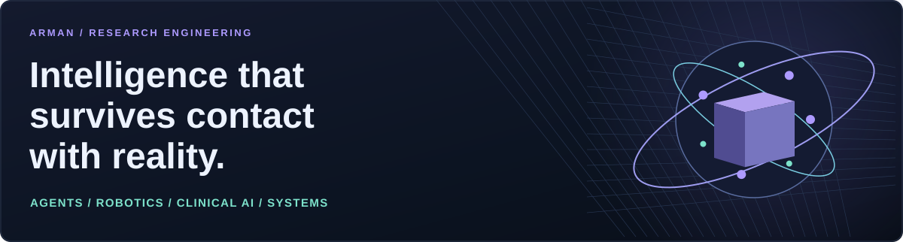

<b>Agentic intelligence · Robotic perception · Evidence-grounded systems</b>

<a href="#research-and-engineering">Research</a> · <a href="#contribution-history">Contributions</a> · <a href="#technical-stack">Stack</a> · <a href="#open-source-and-impact">Open source</a> · <a href="#research-challenge">Interactive challenge</a>

### Research and engineering

I design and evaluate agentic AI, SLAM and navigation, physics-informed estimation, and clinical reasoning systems. My emphasis is on measurable performance, provenance, and maintainable infrastructure.

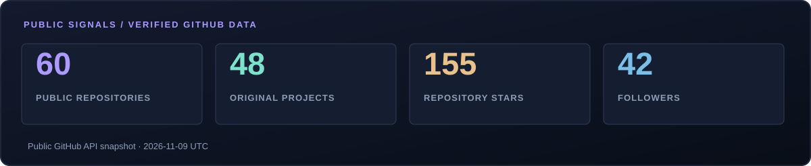

**Research questions:** How can agents generalize across tasks? How can learned state estimation respect physical constraints? How can clinical AI expose evidence and uncertainty?

[Explore repositories](https://github.com/Armanasq?tab=repositories) · [Research evidence](./docs/ARCHITECTURE.md)

## Contribution history

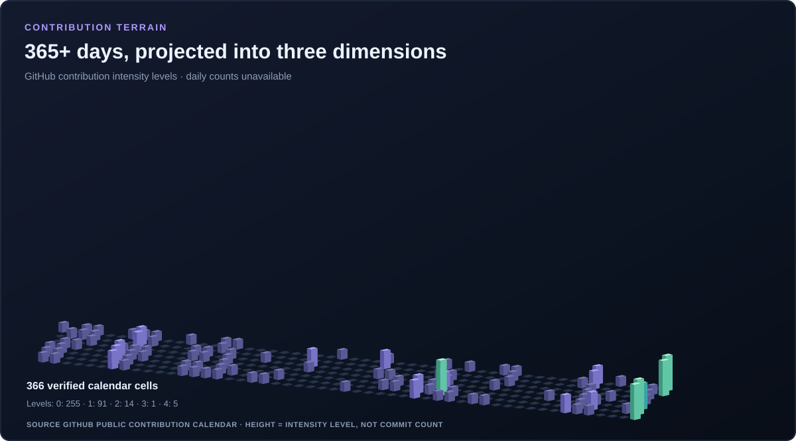

Daily intensity levels are sourced from GitHub's public contribution calendar; no exact commit counts are inferred. [Calendar data](./data/contributions.json).

## Technical stack

**Machine learning and inference**

**Robotics and state estimation:** SLAM · IMU · VQF · navigation · quaternion estimation

**Retrieval and evidence:** SQL · SQLite · PostgreSQL · FTS · RAG · provenance

**Inference and orchestration:** Transformers · CUDA · vLLM · custom Python agent systems

Icon source: [tandpfun/skill-icons](https://github.com/tandpfun/skill-icons). Additional research areas are listed as text to avoid misleading icon substitutions.

<b>Explore the spatial engineering architecture</b>

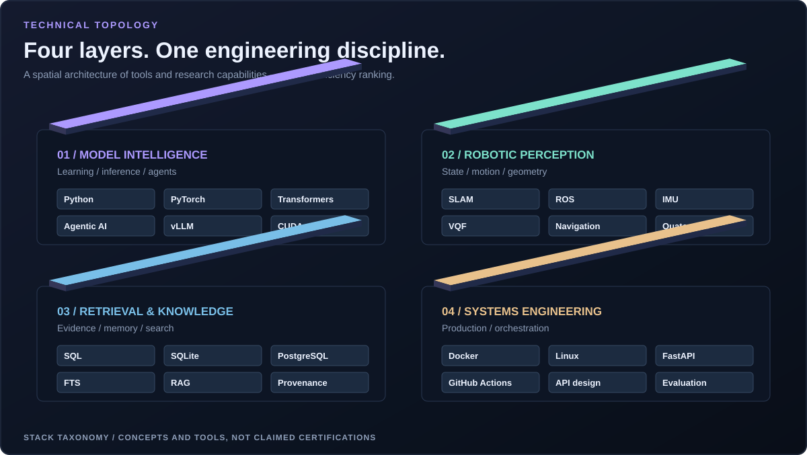

## Open source and impact

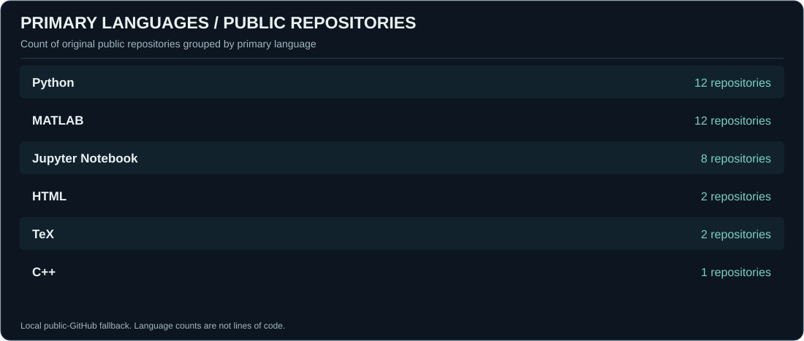 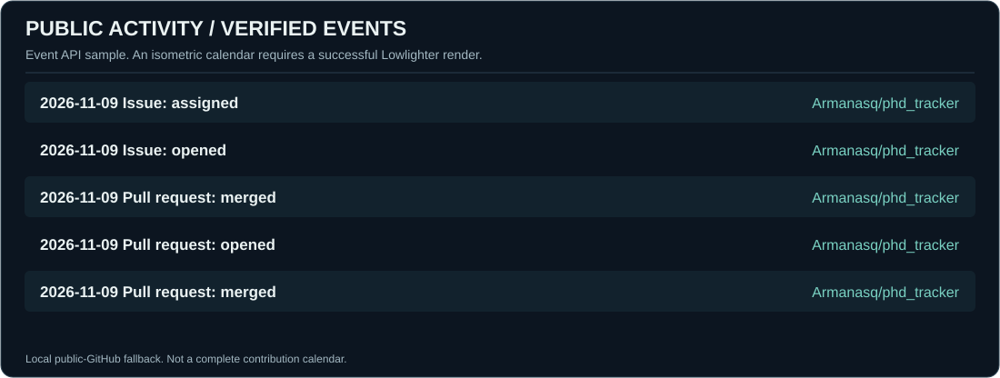

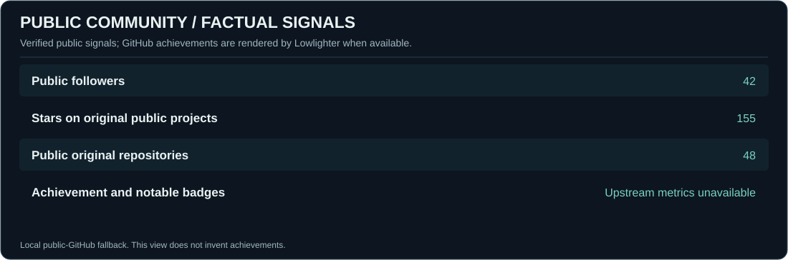 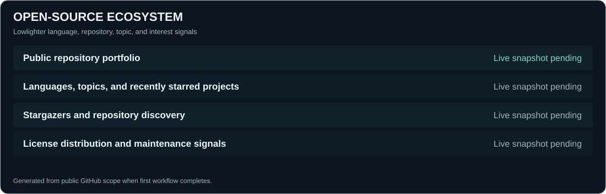

<b>More metrics: language distribution, project skyline, evidence and provenance</b>

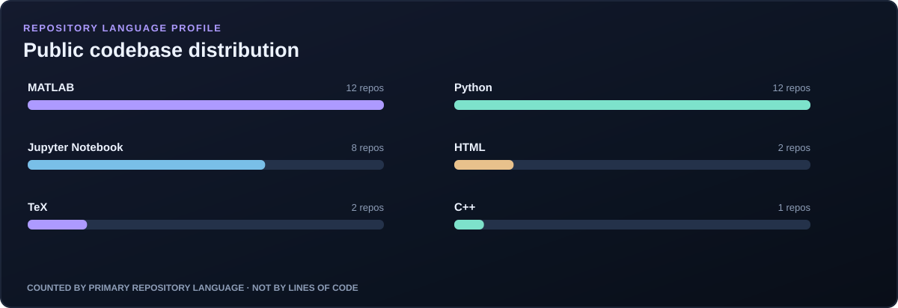
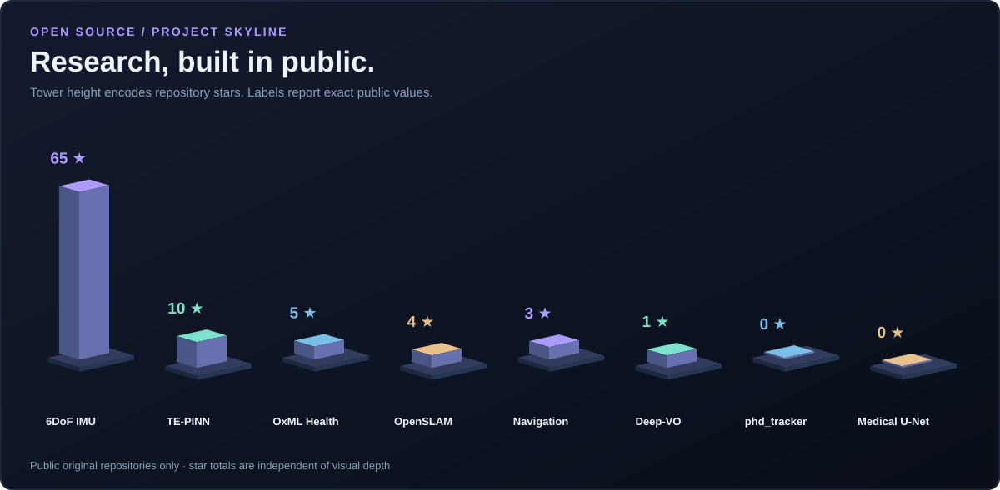
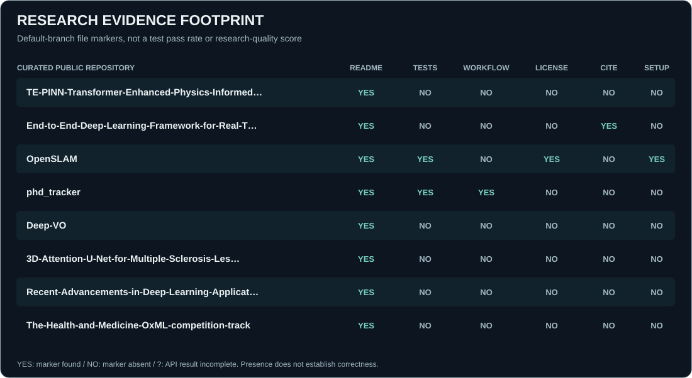
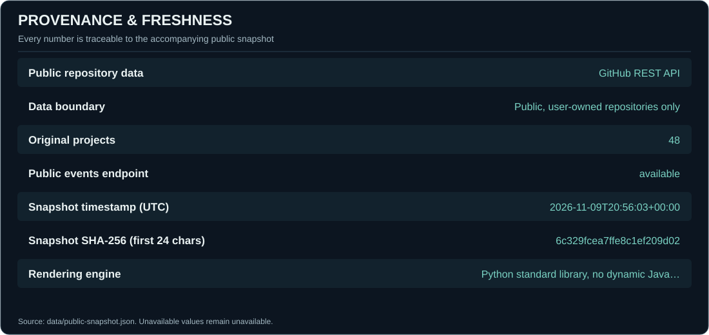

### Public research repositories

<!-- featured:start -->
<table><tr><th>Repository</th><th>Research area</th><th>Stars</th></tr>
<tr><td><a href="https://github.com/Armanasq/End-to-End-Deep-Learning-Framework-for-Real-Time-Inertial-Attitude-Estimation-using-6DoF-IMU">End-to-End-Deep-Learning-Framework-for-Real-Ti...</a></td><td>Inertial state estimation</td><td align="right">65</td></tr>
<tr><td><a href="https://github.com/Armanasq/TE-PINN-Transformer-Enhanced-Physics-Informed-Neural-Network-Quaternion-Orientation-Estimation">TE-PINN-Transformer-Enhanced-Physics-Informed-...</a></td><td>Physics-informed learning</td><td align="right">10</td></tr>
<tr><td><a href="https://github.com/Armanasq/The-Health-and-Medicine-OxML-competition-track">The-Health-and-Medicine-OxML-competition-track</a></td><td>Medical AI</td><td align="right">5</td></tr>
<tr><td><a href="https://github.com/Armanasq/OpenSLAM">OpenSLAM</a></td><td>Robotics and mapping</td><td align="right">4</td></tr>
<tr><td><a href="https://github.com/Armanasq/Recent-Advancements-in-Deep-Learning-Applications-and-Methods-for-Autonomous-Navigation">Recent-Advancements-in-Deep-Learning-Applicati...</a></td><td>Navigation research</td><td align="right">3</td></tr>
<tr><td><a href="https://github.com/Armanasq/Deep-VO">Deep-VO</a></td><td>Visual odometry</td><td align="right">1</td></tr>
</table>
<!-- featured:end -->

### Recent public activity

<!-- activity:start -->
<table><tr><th>Date</th><th>Activity</th><th>Repository</th></tr>
<tr><td>2026-11-09</td><td>Issue: assigned</td><td><a href="https://github.com/Armanasq/phd_tracker">Armanasq/phd_tracker</a></td></tr>
<tr><td>2026-11-09</td><td>Issue: opened</td><td><a href="https://github.com/Armanasq/phd_tracker">Armanasq/phd_tracker</a></td></tr>
<tr><td>2026-11-09</td><td>Issue: assigned</td><td><a href="https://github.com/Armanasq/phd_tracker">Armanasq/phd_tracker</a></td></tr>
<tr><td>2026-11-09</td><td>Issue: opened</td><td><a href="https://github.com/Armanasq/phd_tracker">Armanasq/phd_tracker</a></td></tr>
<tr><td>2026-11-09</td><td>Pull request: merged</td><td><a href="https://github.com/Armanasq/phd_tracker">Armanasq/phd_tracker</a></td></tr>
</table>
<!-- activity:end -->

Tables are generated from the public GitHub API; private work and unverified achievements are excluded.

## Live community signals

These panels use the original third-party rendering services, rather than custom-drawn substitutes. External services may be unavailable or rate-limited; the repository's [verified public snapshot](./data/public-snapshot.json) remains the fallback source.

  

 <a href="https://github.com/Armanasq?tab=repositories">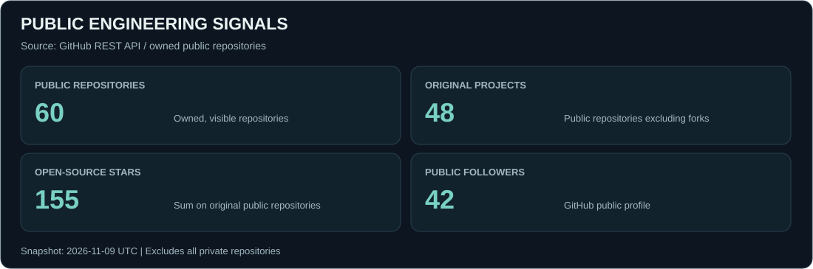</a>

### Contribution animation

<picture>
  <source media="(prefers-color-scheme: dark)" srcset="https://raw.githubusercontent.com/Armanasq/Armanasq/output/github-contribution-grid-snake-dark.svg">
  <source media="(prefers-color-scheme: light)" srcset="https://raw.githubusercontent.com/Armanasq/Armanasq/output/github-contribution-grid-snake.svg">
  
</picture>

Snake assets are generated by [Platane/snk](https://github.com/Platane/snk) and published to the `output` branch by [GitHub Actions](./.github/workflows/contribution-snake.yml). Until the first workflow succeeds, this image may be unavailable.

## Research challenge

**Interactive research decision: which experimental failure would you investigate first?**

Choose a hypothesis to open a prefilled GitHub Issue. A GitHub Actions workflow records and tallies valid choices. No JavaScript or external account is required beyond GitHub.

[**A · Data leakage / invalid split**](https://github.com/Armanasq/Armanasq/issues/new?title=Research%20challenge%3A%20A&body=Hypothesis%3A%20Data%20leakage%20or%20invalid%20evaluation%20split) · [**B · Distribution shift**](https://github.com/Armanasq/Armanasq/issues/new?title=Research%20challenge%3A%20B&body=Hypothesis%3A%20Distribution%20shift) · [**C · Baseline mismatch**](https://github.com/Armanasq/Armanasq/issues/new?title=Research%20challenge%3A%20C&body=Hypothesis%3A%20Baseline%20mismatch)

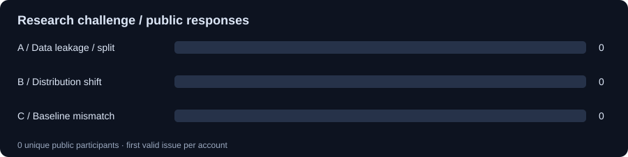

Votes are counted from Issues titled exactly `Research challenge: A`, `Research challenge: B`, or `Research challenge: C`. This is an opinion poll, not an empirical result. [Implementation](./scripts/research_challenge.py).

## Selected research

- [End-to-End Deep Learning Framework for Real-Time Inertial Attitude Estimation using 6DoF IMU](https://github.com/Armanasq/End-to-End-Deep-Learning-Framework-for-Real-Time-Inertial-Attitude-Estimation-using-6DoF-IMU)
- [Recent Advancements in Deep Learning Applications and Methods for Autonomous Navigation](https://github.com/Armanasq/Recent-Advancements-in-Deep-Learning-Applications-and-Methods-for-Autonomous-Navigation)
- [TE-PINN: Transformer-Enhanced Physics-Informed Neural Network for Quaternion Orientation Estimation](https://github.com/Armanasq/TE-PINN-Transformer-Enhanced-Physics-Informed-Neural-Network-Quaternion-Orientation-Estimation)

**Evidence before interpretation · Baselines before novelty · Engineering beyond demonstrations**

[Public data](./data/public-snapshot.json) · [Automation](./.github/workflows/profile.yml) · [Implementation notes](./docs/PROFILE_FEATURES.md)
