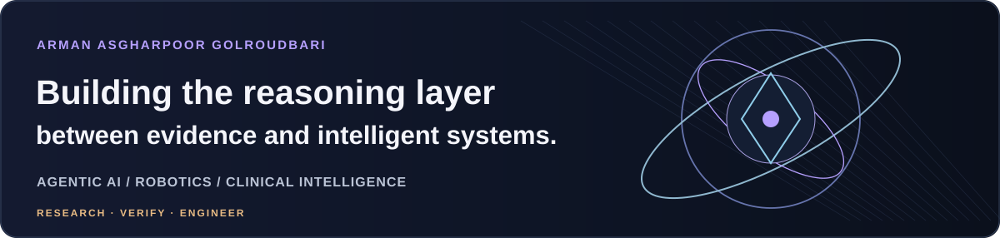
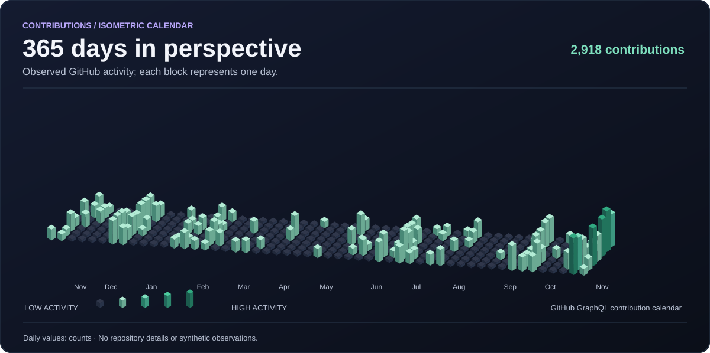
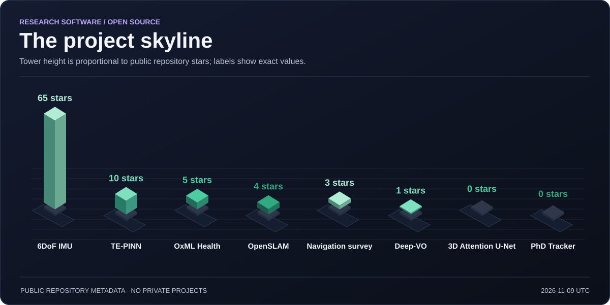
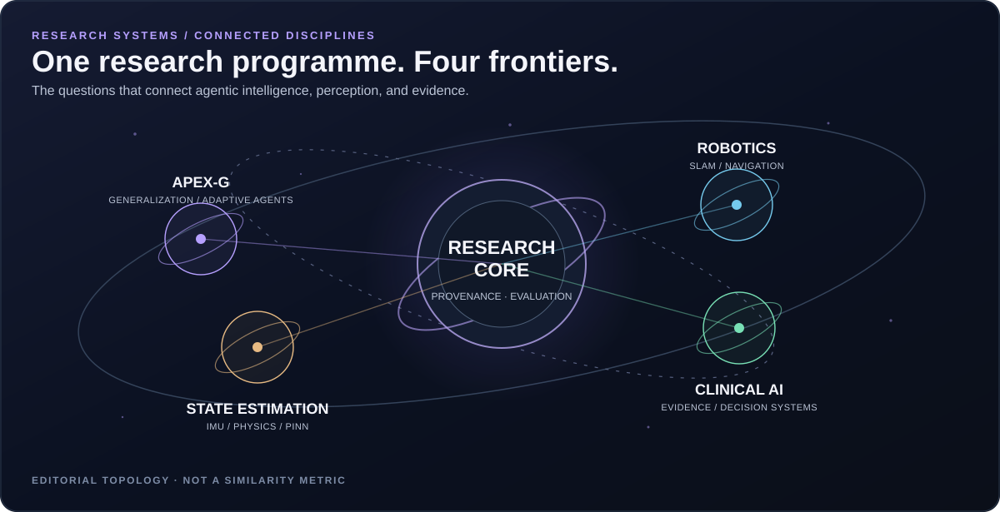

<picture><source media="(prefers-color-scheme: dark)" srcset="./assets/visuals/research-hero.svg"><source media="(prefers-color-scheme: light)" srcset="./assets/visuals/research-hero.svg"></picture>

<a href="#contributions-in-perspective">3D contributions</a> &nbsp; · &nbsp; <a href="#the-project-skyline">Project skyline</a> &nbsp; · &nbsp; <a href="#research-universe">Research universe</a> &nbsp; · &nbsp; <a href="#research-evidence">Evidence</a> &nbsp; · &nbsp; <a href="#lowlighter-metrics">Metrics</a>

**Agentic AI engineer · Applied machine learning researcher · Robotics and navigation · Clinical AI.** I build source-grounded systems that preserve state, expose uncertainty, and survive evaluation beyond polished demonstrations.

## Contributions in perspective

The isometric calendar is generated from GitHub's own daily contribution data. If the API cannot supply a complete period, the visualization explicitly reports the gap; it never uses fabricated activity. [Inspect the underlying data](./data/contributions.json).

## The project skyline

Data source: [public GitHub repository snapshot](./data/public-snapshot.json). Tower heights have a linear scale; labels show exact star counts. Private research is excluded.

## Research universe

<b>Explore the research programmes and verified repositories</b>

| Direction | Research question | Public reference |
|:---|:---|:---|
| **APEX-G / adaptive learning** | How can agents generalize, persist knowledge, and improve over tasks? | Research in progress; source repository is private |
| **Evidence-grounded clinical AI** | How can multi-turn reasoning preserve state, provenance and safety? | Private implementation; no public repo link |
| **Physics-informed estimation** | Can learned state estimation satisfy kinematic constraints? | [TE-PINN](https://github.com/Armanasq/TE-PINN-Transformer-Enhanced-Physics-Informed-Neural-Network-Quaternion-Orientation-Estimation) |
| **Inertial navigation** | How should learned systems estimate orientation under sensor uncertainty? | [6DoF IMU attitude estimation](https://github.com/Armanasq/End-to-End-Deep-Learning-Framework-for-Real-Time-Inertial-Attitude-Estimation-using-6DoF-IMU) |
| **Robotic mapping** | How can systems integrate perception, localization, and mapping? | [OpenSLAM](https://github.com/Armanasq/OpenSLAM), [Deep-VO](https://github.com/Armanasq/Deep-VO) |
| **Research operations** | How can automated research workflows retain traceability? | [PhD Tracker](https://github.com/Armanasq/phd_tracker) |

## Research evidence

<b>Research pipeline: from question to reproducible system</b>

File markers indicate only whether documentation, tests, workflows, licence, citation, or environment files exist; they do not demonstrate empirical quality or test success.

## Lowlighter metrics

The following panels are generated with [Lowlighter Metrics](https://github.com/lowlighter/metrics) when upstream rendering succeeds. Source-backed public data is displayed as a fallback if it does not.

<table><tr><td width="50%"></td><td width="50%"></td></tr><tr><td></td><td></td></tr></table>

<b>Provenance, verified activity and full repository radar</b>

## Publications and technical writing

- [End-to-End Deep Learning Framework for Real-Time Inertial Attitude Estimation using 6DoF IMU](https://github.com/Armanasq/End-to-End-Deep-Learning-Framework-for-Real-Time-Inertial-Attitude-Estimation-using-6DoF-IMU) — *Measurement* (2023), research code.
- [Recent Advancements in Deep Learning Applications and Methods for Autonomous Navigation](https://github.com/Armanasq/Recent-Advancements-in-Deep-Learning-Applications-and-Methods-for-Autonomous-Navigation) — survey materials.
- [TE-PINN orientation estimation](https://github.com/Armanasq/TE-PINN-Transformer-Enhanced-Physics-Informed-Neural-Network-Quaternion-Orientation-Estimation) — experimental implementation, with no invented publication status.

---

**Evidence before interpretation. Baselines before novelty. Explicit state before elaborate orchestration.**

[GitHub](https://github.com/Armanasq) · [LinkedIn](https://www.linkedin.com/in/asgharpoor/) · [Research architecture](./docs/ARCHITECTURE.md) · [Email](mailto:A.Asgharpoor@ut.ac.ir)
