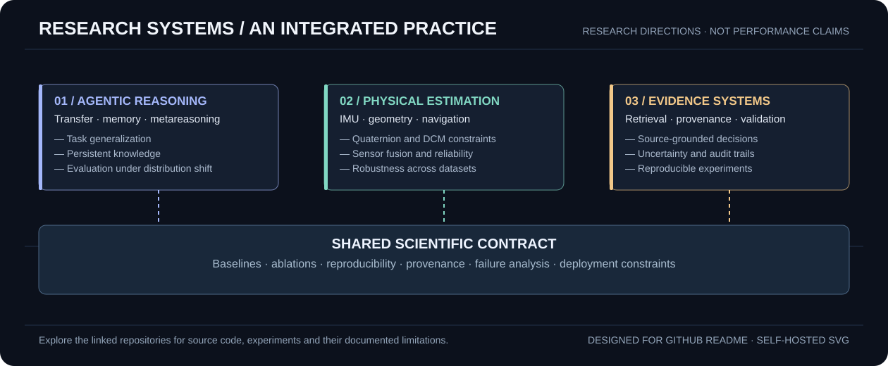

<b>Research systems, not demonstrations.</b> Agentic reasoning · Robotics and navigation · Physics-informed learning · Evidence-grounded AI

<a href="#research-systems">Research systems</a> · <a href="#open-research">Open research</a> · <a href="#engineering-signals">Engineering signals</a> · <a href="#research-experiment">Experiment</a>

## Research systems

A connected research practice spanning autonomous reasoning, embodied state estimation, and evidence-grounded decision systems. The diagram below distinguishes **research directions**, **methods**, and **evaluation obligations**; it is a conceptual map, not a claim of completed experimental results.

| Research direction | Engineering question | Primary evidence |
|:--|:--|:--|
| **Agentic reasoning** | How can agents transfer and retain knowledge across tasks? | [APEX-G](https://github.com/Armanasq/APEX-G) |
| **Robotic perception** | How can estimation respect sensor and physical constraints? | [6DoF IMU research](https://github.com/Armanasq/End-to-End-Deep-Learning-Framework-for-Real-Time-Inertial-Attitude-Estimation-using-6DoF-IMU) |
| **Physics-informed learning** | How should learned dynamics and geometric constraints interact? | [TE-PINN](https://github.com/Armanasq/TE-PINN-Transformer-Enhanced-Physics-Informed-Neural-Network-Quaternion-Orientation-Estimation) |
| **Research tooling** | How can research decisions be traceable and reproducible? | [PhD Tracker](https://github.com/Armanasq/phd_tracker) |

<b>Methods and infrastructure</b>

**Learning:** PyTorch, Transformers, model serving, inference optimization

**Robotics:** IMU, SLAM, state estimation, orientation and navigation

**Evidence:** SQL, structured retrieval, provenance, experimental baselines

**Systems:** Python, FastAPI, Docker, Linux, GitHub Actions

## Open research

Visual height represents GitHub contribution **intensity levels**, not exact daily commit counts. [Source data](./data/contributions.json).

### Selected public repositories

<!-- featured:start -->
<table><tr><th>Repository</th><th>Research area</th><th>Stars</th></tr>
<tr><td><a href="https://github.com/Armanasq/End-to-End-Deep-Learning-Framework-for-Real-Time-Inertial-Attitude-Estimation-using-6DoF-IMU">End-to-End-Deep-Learning-Framework-for-Real-Ti...</a></td><td>Inertial state estimation</td><td align="right">65</td></tr>
<tr><td><a href="https://github.com/Armanasq/TE-PINN-Transformer-Enhanced-Physics-Informed-Neural-Network-Quaternion-Orientation-Estimation">TE-PINN-Transformer-Enhanced-Physics-Informed-...</a></td><td>Physics-informed learning</td><td align="right">10</td></tr>
<tr><td><a href="https://github.com/Armanasq/The-Health-and-Medicine-OxML-competition-track">The-Health-and-Medicine-OxML-competition-track</a></td><td>Medical AI</td><td align="right">5</td></tr>
<tr><td><a href="https://github.com/Armanasq/OpenSLAM">OpenSLAM</a></td><td>Robotics and mapping</td><td align="right">4</td></tr>
<tr><td><a href="https://github.com/Armanasq/Recent-Advancements-in-Deep-Learning-Applications-and-Methods-for-Autonomous-Navigation">Recent-Advancements-in-Deep-Learning-Applicati...</a></td><td>Navigation research</td><td align="right">3</td></tr>
<tr><td><a href="https://github.com/Armanasq/Deep-VO">Deep-VO</a></td><td>Visual odometry</td><td align="right">1</td></tr>
</table>
<!-- featured:end -->

<b>Recent verified public activity</b>

<!-- activity:start -->
<table><tr><th>Date</th><th>Activity</th><th>Repository</th></tr>
<tr><td>2026-11-09</td><td>Issue: assigned</td><td><a href="https://github.com/Armanasq/phd_tracker">Armanasq/phd_tracker</a></td></tr>
<tr><td>2026-11-09</td><td>Issue: opened</td><td><a href="https://github.com/Armanasq/phd_tracker">Armanasq/phd_tracker</a></td></tr>
<tr><td>2026-11-09</td><td>Issue: assigned</td><td><a href="https://github.com/Armanasq/phd_tracker">Armanasq/phd_tracker</a></td></tr>
<tr><td>2026-11-09</td><td>Issue: opened</td><td><a href="https://github.com/Armanasq/phd_tracker">Armanasq/phd_tracker</a></td></tr>
<tr><td>2026-11-09</td><td>Pull request: merged</td><td><a href="https://github.com/Armanasq/phd_tracker">Armanasq/phd_tracker</a></td></tr>
</table>
<!-- activity:end -->

[Source snapshot](./data/public-snapshot.json)

## Engineering signals

The core visuals below are **repository-hosted** and rendered by scheduled automation. The page does not depend on third-party image endpoints for its primary layout.

<b>Detailed metrics and provenance</b>

## Research experiment

**Which failure mode should a researcher investigate first when an apparently strong model fails to reproduce?**

| Hypothesis | Audit target |
|:--|:--|
| [A · Evaluation leakage](https://github.com/Armanasq/Armanasq/issues/new?title=Research%20challenge%3A%20A) | Split boundaries, preprocessing leakage and duplicate samples |
| [B · Distribution shift](https://github.com/Armanasq/Armanasq/issues/new?title=Research%20challenge%3A%20B) | Domain, temporal and sensor shift |
| [C · Baseline mismatch](https://github.com/Armanasq/Armanasq/issues/new?title=Research%20challenge%3A%20C) | Preprocessing parity, compute budgets and metrics |

Issue-driven opinion poll, not scientific evidence. [Counting logic](./scripts/research_challenge.py) · [Workflow](./.github/workflows/research-challenge.yml).

---

[Research architecture](./docs/RESEARCH_SYSTEMS.md) · [Verified snapshot](./data/public-snapshot.json) · [Automation](./.github/workflows/profile.yml) · [Source integrations](./docs/UPSTREAM_INTEGRATIONS.md)
