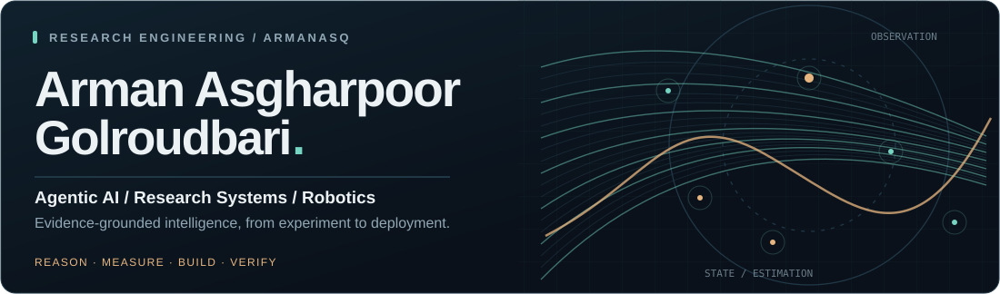
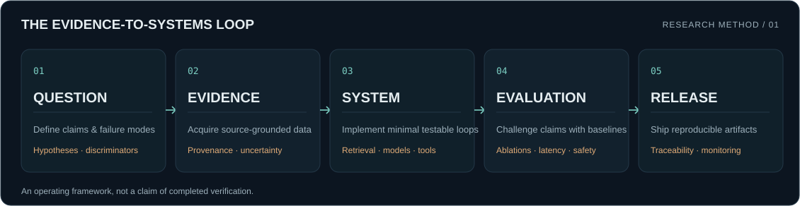
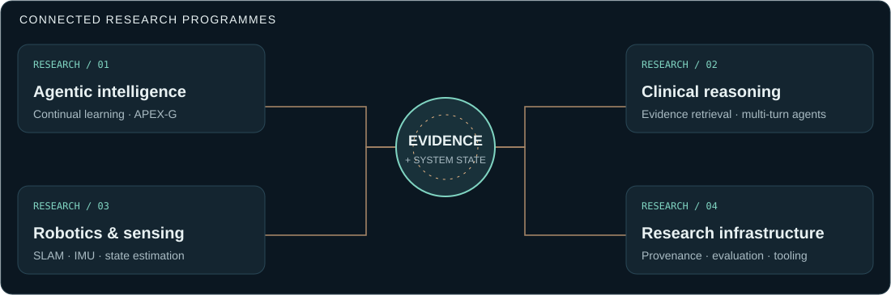
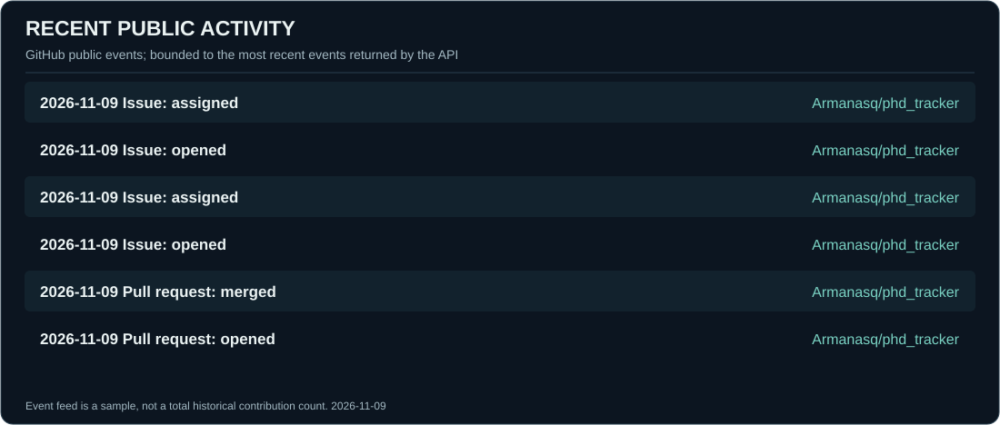
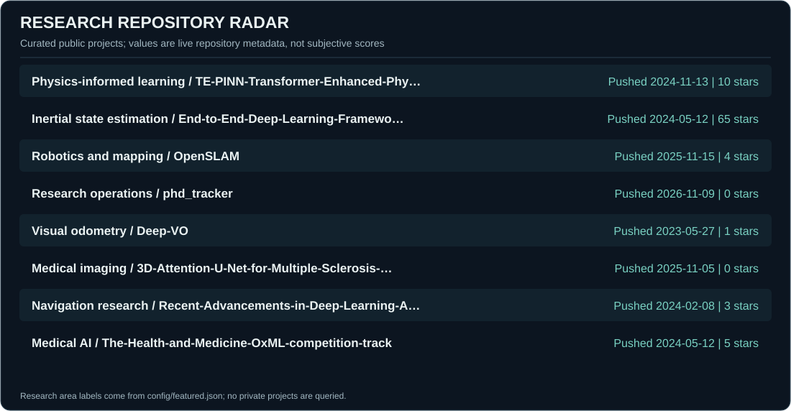

  <picture>
    <source media="(prefers-color-scheme: dark)" srcset="./assets/hero-dark.svg">
    <source media="(prefers-color-scheme: light)" srcset="./assets/hero-light.svg">
    
  </picture>

  <a href="#research-directions">Research</a> &nbsp;·&nbsp;
  <a href="#selected-public-work">Open-source systems</a> &nbsp;·&nbsp;
  <a href="#research-method">Method</a> &nbsp;·&nbsp;
  <a href="#live-github-instrumentation">Telemetry</a> &nbsp;·&nbsp;
  <a href="#writing-and-publications">Publications</a>

I develop **agentic AI and research systems** that connect scientific investigation with reliable software. My interests span persistent learning and generalization, multi-turn clinical reasoning, evidence retrieval, inertial state estimation, robotics, and applied machine learning.

Rather than treating benchmarks, demos, or model outputs as evidence on their own, I focus on **source provenance, explicit system state, reproducible evaluation, and measurable failure modes**.

## Research directions

| Research programme | Central technical question | Current surface |
|:---|:---|:---|
| **APEX-G** · adaptive problem-solving | How should agents acquire, retain, and transfer capabilities across tasks? | Active research; source repository is private |
| **Clinical reasoning systems** | How can multi-turn agents maintain state and connect conclusions to auditable clinical evidence? | Private implementation; public technical context below |
| **State estimation and navigation** | How can learned models respect physical constraints and operate under sensor uncertainty? | [TE-PINN](https://github.com/Armanasq/TE-PINN-Transformer-Enhanced-Physics-Informed-Neural-Network-Quaternion-Orientation-Estimation) · [IMU attitude estimation](https://github.com/Armanasq/End-to-End-Deep-Learning-Framework-for-Real-Time-Inertial-Attitude-Estimation-using-6DoF-IMU) |
| **Research operations** | How do we make literature, decisions, evaluations, and action history inspectable? | [PhD Tracker](https://github.com/Armanasq/phd_tracker) |

## Selected public work

| System / research artifact | What it demonstrates |
|:---|:---|
| [**TE-PINN — Transformer-Enhanced Physics-Informed Orientation Estimation**](https://github.com/Armanasq/TE-PINN-Transformer-Enhanced-Physics-Informed-Neural-Network-Quaternion-Orientation-Estimation) | Quaternion kinematics, physics-informed learning, and IMU orientation estimation |
| [**End-to-End Inertial Attitude Estimation (6DoF IMU)**](https://github.com/Armanasq/End-to-End-Deep-Learning-Framework-for-Real-Time-Inertial-Attitude-Estimation-using-6DoF-IMU) | Neural inertial-attitude estimation associated with the 2023 Measurement publication |
| [**OpenSLAM**](https://github.com/Armanasq/OpenSLAM) | Exploration of localization, mapping, and open robotics systems |
| [**PhD Tracker**](https://github.com/Armanasq/phd_tracker) | Research-application tracking, structured workflows, and automation |
| [**Deep-VO**](https://github.com/Armanasq/Deep-VO) | Deep-learning approaches to visual odometry |
| [**3D Attention U-Net for MS lesion segmentation**](https://github.com/Armanasq/3D-Attention-U-Net-for-Multiple-Sclerosis-Lesion-Segmentation) | Volumetric medical image segmentation |
| [**Autonomous Navigation: Deep Learning Survey**](https://github.com/Armanasq/Recent-Advancements-in-Deep-Learning-Applications-and-Methods-for-Autonomous-Navigation) | Literature-driven study of navigation and mapping methods |

Public links are shown only for repositories verified as public. Private research is not used in the telemetry calculations.

## Research method

<b>Open research architecture</b> — a cross-domain map of the problems I study

 

## Live GitHub instrumentation

GitHub data is refreshed by an automated workflow. Charts show **public information only**, with the date and scope defined in the generated source snapshot. Repository language bytes are **not** a measure of programming ability.

### Lowlighter metrics laboratory

Extended metrics use the [Lowlighter Metrics](https://github.com/lowlighter/metrics) engine, including recognition, notable work, language distribution, habits, repository topics, community, and an isometric contribution calendar. Each panel is published as a versioned repository asset; a missing API scope must not be represented by a fabricated zero.

<b>Research footprint</b> · languages, code, and development activity

 

<b>Contributions in time</b> · isometric calendar and recent activity

 

<b>Recognition &amp; collaborators</b> · achievements, notable contributions, and people

 

<b>Open-source ecosystem</b> · repositories, topics, stars, and license footprint

 

<b>Data lineage</b> · provenance and freshness

 

## Writing and publications

- [**End-to-End Deep Learning Framework for Real-Time Inertial Attitude Estimation using 6DoF IMU**](https://github.com/Armanasq/End-to-End-Deep-Learning-Framework-for-Real-Time-Inertial-Attitude-Estimation-using-6DoF-IMU) — *Measurement* (2023); research code.
- [**Recent Advancements in Deep Learning Applications and Methods for Autonomous Navigation**](https://github.com/Armanasq/Recent-Advancements-in-Deep-Learning-Applications-and-Methods-for-Autonomous-Navigation) — survey repository.
- [**TE-PINN: Quaternion Orientation Estimation**](https://github.com/Armanasq/TE-PINN-Transformer-Enhanced-Physics-Informed-Neural-Network-Quaternion-Orientation-Estimation) — experimental implementation; no unverified publication or acceptance claim.

## Engineering principles

**Evidence before interpretation.** **Explicit state before elaborate orchestration.** **Baselines before novelty claims.** **Reproducibility before presentation.**

Work typically uses Python, PyTorch, SQL, CUDA, ROS, containerized infrastructure, and production-oriented inference systems. The relevant tool is selected by the technical requirement, not by a technology badge.

---

GitHub · <a href="https://github.com/Armanasq">Armanasq</a> &nbsp; / &nbsp; <a href="https://www.linkedin.com/in/asgharpoor/">LinkedIn</a> &nbsp; / &nbsp; <a href="mailto:A.Asgharpoor@ut.ac.ir">Email</a> &nbsp; / &nbsp; <a href="./docs/ARCHITECTURE.md">How this profile works</a>

Custom visuals are authored for this repository; telemetry uses public GitHub data and <a href="https://github.com/lowlighter/metrics">Lowlighter Metrics</a>. Private repository data is intentionally excluded from public snapshots.
